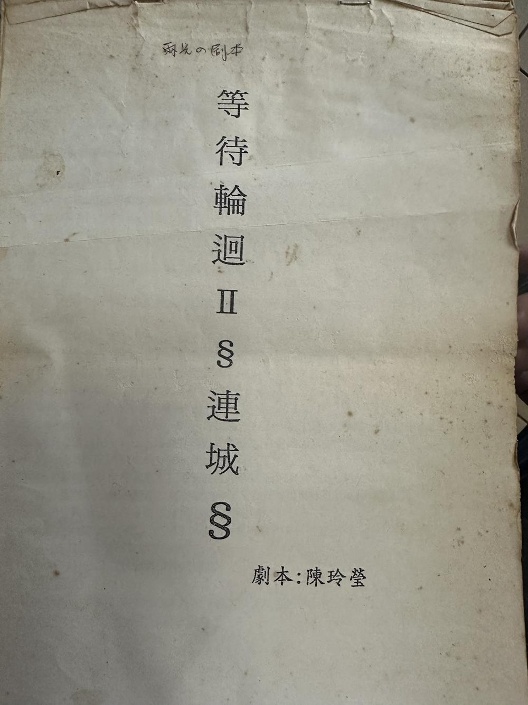

小吃店的門簾被雨水打得沉甸甸的，王澤顏一頭撞進去，帶進來一陣潮味。

「老闆，我們十幾個人！」

老闆從灶台後面抬起頭，看見一群穿著半古裝、半現代的年輕人湧進門，手裡還拎著帽子、袍子、花，愣了三秒，認命地把桌子併在一起。

人坐定的時候，伯彥和淑芬才從門外鑽進來。傘收了，傘尖在地上滴出一小攤水。傘不大，兩個人各濕了半邊，伯彥的肩膀濕得更多。淑芬把傘立在門邊，沒有去看他，只是把自己那邊的頭髮擰了擰，擰出一股細水，滴在水泥地上。

有人嚷著要乾麵，有人要湯麵，有人問有沒有滷味。旁邊的人笑他剛才不是說不餓，他回嘴現在餓了不行嗎。

小柏坐在靠牆的位子，花擱在腿邊。玻璃紙貼著他的小腿，沙沙響。對面的圓圓拿起筷子，翻了一下碗，又放下，開口，「成績下禮拜公布。」

桌子安靜了半秒。

「我先講，」她說，「不要抱期待。」

「我們有期待。」王澤顏說。

「那你就期待到下禮拜。」

伯彥舉起茶杯。杯子是塑膠的，上面印著一個褪色的紅雙喜。他舉到一半，不知道說什麼，又放下，又舉起。「那個，」他說，「我們演完了。」

所有人看著他。

「就這樣。」他說，「我們演完了。」

沒有人笑他。杯子一個一個舉起來，塑膠杯碰塑膠杯，聲音鈍鈍的，沒有玻璃那種脆響。可是十幾個杯子碰在一起，桌面上的水晃了一圈。

仲承和芬蘭坐在桌子兩頭，隔著半張桌子。芬蘭碗裡的湯面浮著一層油花，她吹了一口，抬頭，剛好對上仲承的視線。兩個人同時移開。

芬蘭的麵吃到一半，她從口袋裡摸出一顆薄荷糖，沒有看誰，放在仲承的碗邊，指尖在桌面上點了一下，縮回去。仲承盯著那顆糖，盯了很久，沒有去拿。他把筷子換到左手，右手悄悄蓋住了它。

老闆端麵過來，在碗底下加了一句，「你們這群人，吵死了。」

沒有人聽進去。

吃到後來，人聲像水一樣漫過桌面。小柏沒有吃多少，他把麵碗推到一邊，聽著，一個一個聽：王澤顏在講他的王化成被拒絕的那一刻，圓圓罵他不要加戲，小蝶學拐杖，嬤嬤在笑，伯彥幫淑芬把醬油瓶挪遠，免得她手一揮打翻。

他從來沒有這樣仔細地聽過任何一頓飯。

散席時，雨停了。

地面是乾的，路燈圈出一個一個黃色的池，空氣裡有一種剛洗過的、不屬於冬天的暖。大家三三兩兩走出去，有人往宿舍的方向，有人往公車站。

「明天見！」

「醒得來再說！」

「小柏！」

王澤顏站在路燈底下，朝他揮手。「走了啦！」

「來了。」

小柏抱著花，往前走。可是不知道為什麼，路燈底下的人影，比剛才遠了一些。他加快腳步，影子在腳下拉得很長，卻怎麼也追不上。他低頭看，手裡沒有拐杖，可是每一步都踩得很穩。

「小柏。」

有人在叫他。很輕，像隔著一層水。

他回頭，沒有人。

再轉回來的時候，路燈不見了。

＊＊＊

眼前是一條小徑。

石階被人重新鋪過，每一塊都平平整整，邊緣磨得圓。兩旁的花樹開得正好，一整條路都是白的，花瓣落在石縫裡，沒有人掃。風不大，從樹梢過去的時候，整條小徑跟著呼吸。

小徑盡頭，站著兩個人。

女孩穿著淺色的衣裳，臉色比他記憶裡的紅潤，手裡拿著一枝剛折下來的花，不是玻璃紙裹著的，是帶著枝葉和水氣的。她身旁站著一個書生，一身舊衫，腳上的鞋，一隻深，一隻淺，並肩站著，沒有靠近，也沒有離開。

女孩回過頭。

她看見他，眼睛彎了一下，像水面掠過一隻燕子。

「爹，」她說，「快些，花要開盡了。」

他的喉頭動了一下。

他想起舞台上，自己拄著拐杖，對著芬蘭說過一句話：「明日若能出門，爹便只陪妳看花。」

那是台詞。

可此刻，他看著那條路，看著那兩個人，才明白，這句台詞一直在等人把它說完。

書生朝他欠身，叫了一聲「伯父」，聲音很穩，腰彎得很低。他看見書生袖口的線頭，和那雙一深一淺的鞋。

女孩看著他空著的手。

「爹，你的拐杖呢？」

「忘在後頭了。」

「不要緊。」她說，「路已經修平了。」

他低頭，腳下的石階一塊接一塊，沒有一塊翹著邊。

他把手從口袋裡拿出來。

「來了。」他說。

這一次，他沒有追。他走。一步，一步，穩穩地走過那些平整的石階，走過滿地的花瓣，走到她身邊。她把花遞給他，他接過來，手指碰到她的指尖，是暖的。

「這一枝是給爹的。」她說，「謝謝爹，陪我來。」

他想說不用謝，喉嚨卻像被花瓣堵住了。書生跟在後面一步，手裡提著一只藥罐，罐口冒著白氣，不燙，是剛剛好可以入口的溫度。

身後有很多聲音在叫他，「爹爹」，「小柏」，「快一點啦」，一聲一聲，不催，像一群人在路燈底下等一個人。

他回頭看了一眼，朝那些聲音點點頭，像在說：我看完花就回來。

花瓣落在肩上，涼涼的。他想，這大概是夢吧。若是夢，就讓他把這一段走完。他握著那枝花，和她並肩，往前走了一小段。

＊＊＊

我醒了。

掌心裡有一點涼，像剛握過花莖。我把手攤開，什麼也沒有。那條路，是夢裡才有的路。

窗簾沒有拉好，一道亮光從縫裡切進來，落在地板上。房間很安靜。沒有王澤顏的聲音，沒有誰在喊再來一次。

我躺著，聽自己的心跳，一下一下，很穩。很久沒有動。

手機在床頭震了一下。我拿起來，螢幕亮起，日期在最上面：2026年2月12日。

二十八年了。

我握著手機，沒有點開。我低頭看自己的手，指節粗了，右手食指有一層長年握筆壓出來的繭，和夢裡那雙拿過拐杖的手，不太一樣。窗外有機車駛過，輪胎碾過路面的水，一路嘩嘩地遠去。剛才夢裡的雨停了，可這裡昨夜是真的下過。

我下了床，走到書桌前坐下。

小柏。

這個名字，已經很多年沒有人這樣叫我了。那是一九九八年，一群大學生隨口起的稱呼，叫了幾個月，畢業之後就沒有再用過。我自己幾乎忘了。剛才在夢裡，有人隔著一層水喊我，我才發現，我居然沒有忘。

書桌上放著一份舊劇本。紙邊已經泛黃，釘書針鏽成了褐色，封面上印著五個字：

《等待輪迴Ⅱ－連城》

一九九八年，實踐大學高雄校區，羅門劇團，我們演的是《Ⅱ》。我現在寫的這個，是《Ⅲ》。

我翻開第一頁。第一場，〈自由〉。芬蘭的第一句台詞，仲承的長笛，是我們整齣戲的開頭。

我沒有看得很久。我翻到第十七場，把劇本翻過去，背面有一排鉛筆字，字跡歪斜，筆頭被我咬過的牙印還留在紙上：

人生如戲，人迷戲；
戲如人生，戲迷人。

那是我自己的筆跡。

原本那張卡片，早就不見了。搬過幾次家，不知道夾在哪本書裡，翻遍了也沒有找到。幸好那一晚，我鬼使神差地把它抄在劇本背面，抄得很慢，像在描摹。

我一直不知道那個女孩是誰。

那天晚上，她抱著一束花，走到我面前，問我：連老爺有沒有陪連城去看花。我說劇本寫到那裡就停了。她說：那，如果以後有人替他去看了，就好了。

我當時沒有聽懂。

還有那條緞帶，深青色。後來我寫連城替喬年挑鞋面的布，寫到顏色的時候，手不由自主，寫了同一種。落筆時我沒有察覺，直到現在，也說不出為什麼。

我也不打算想知道。

＊＊＊

桌上還放著一張照片。

那捲底片，一個禮拜之後才洗出來。圓圓拿到手，一張一張翻過去，在其中一張停住，加洗了十幾張，一人發一份。我那一份，收了二十八年，搬了四次家，沒有丟。那是謝幕之後的大合照，攝影社的學弟蹲在人堆最前面，才把所有人的臉塞進同一個畫面。

我拿起來看。

每個人都在笑，嘴巴張得很開，眼睛瞇成一條縫。伯彥的衣領被淑芬翻正了一半。王澤顏的帽子歪了，歪到只剩一側。仲承站在最後排，剛好在芬蘭身後兩排。小蝶舉著兩根手指在嬤嬤頭上。圓圓蹲在最前面，鼻尖紅紅的。

我在最右邊，只露出半個身子，拐杖的頭比人先進了鏡頭。那是第三張，我本來沒有要入鏡，是被學弟喊進去的。我的眼睛沒有看鏡頭，看的是旁邊的人，一個一個，像在清點什麼。

當時我在清點什麼，我說不清。現在我知道了。

我在把他們記下來。

比賽成績，後來也公布了。那年我們進了決賽，沒有拿到名次，只得了一張佳作的獎狀。圓圓把獎狀貼在排練場牆上，貼得歪歪的，說：歪一點，才像我們。

後來，我們都畢業了。

伯彥和淑芬在畢業那年秋天結了婚。喜帖上印的時間是下午三點整，伯彥提早了半個鐘頭，站在門口等她。淑芬後來常說，她等了他一輩子，就為了看他提早到的這一次。他們家那把傘，斷了一根骨，伯彥每年說要換新的，每年都沒有換。

仲承去了台北，芬蘭留在高雄，兩個人沒有再走到一起，也沒有斷。群組開了以後，每年二月十二日，仲承會丟一段長笛的錄音，沒有一個字說明。芬蘭每年回同樣的一句：

「拜託，別再吹了！」

一年也沒有漏過。

手機又震了一下。我點開群組。凌晨六點四十分，一段長笛，三分鐘。底下，已經有人回了：

拜託，別再吹了！

然後是淑芬發了一張傘的照片，底下一行字：還在用。再底下，是圓圓，只有四個字：

再來一次。

我看著那四個字，笑了出來。三分鐘以後，群組裡，長笛又響了一遍。

往年我只聽開頭幾個音，知道是它，就往下滑。今天我把手機平放在桌上，兩隻手挪開，讓它自己走。起頭有些緊，像手指還沒有暖。中段有一口氣換得很長，長得我以為斷了，身子不由得往前傾，下一個音才接上來。快到結尾，有一個音吹高了。仲承沒有停下來重吹，帶著那個音，一直往下走。最後一聲收掉以後，還剩一點沙沙的空白。我等進度條走到底，才抬起頭。

這個群組，我一個字也沒有發過。這麼多年，我只是看，像站在側幕第二根柱子旁邊，看一場不落幕的戲，不上台。

王澤顏在台北教表演課，第一堂的第一句話，二十年沒變：「我當年演王化成的時候。」小蝶和嬤嬤住在同一個社區，週末一起去一個業餘劇團，一個演主角的母親，一個演主角的鄰居。

圓圓後來真的走上了導演這一行。她的錢包裡，有一小塊壓得發亮的白膠帶，是一九九八年那個晚上，她從第十七場的位置撕下來的。她說，那是她唯一沒有還給別人的東西。有一次，攝影棚裡所有人都收工了，她一個人留在空棚，對著黑掉的場子站了一會兒，才按下開關。

＊＊＊

我把手機放下。

窗外的陽光移進來，爬到桌角。我看著那一束光，想起剛才夢裡那條小徑。

夢是我自己做的，連那條路上的花，也是我自己補的。那是我寫給連城的路：一個活下來的人，自己走出院門的路。

我必須誠實地說這件事。夢裡那些人的心事，淑芬站在側幕想什麼，芬蘭咬著糖想什麼，圓圓在空椅子面前說了什麼，我都是聽不到的。我當年只站在邊上，一個一個看。那些人心裡的話，是這二十八年裡，我一點一點替他們補上的。有的補得準，有的補得不準，我自己也分不清。

我知道的，只有這幾件：

淑芬喊出「我會等你一輩子」的那個晚上，伯彥真的站在第二根柱子旁邊，一步也沒有離開。

第十七場，芬蘭說「也許吧」的時候，我站在那盞燈裡，聽得最清楚。燈的熱度落在後頸上，像一隻手，壓住我，不讓我回頭。

謝幕之後，圓圓真的蹲在最前面，說冷氣太強。

還有，一個不認識的女孩，送了我一束花。

其餘的，是我補的。

我坐在這裡想了很久，為什麼補。

因為口袋裡有兩句話，裝了二十八年。一句是圓圓說的：你想知道，就自己寫。一句是那個女孩說的：如果以後有人替他去看了，就好了。我把它們揣著，搬過幾次家，換過幾份工作，一直沒有拿出來，直到今年。

我寫連城，寫了八十多集。寫她生病、寫她等人、寫她終於推開院門的那一天。我寫喬年的米缸，寫連父那個叫「連兒」的小名，寫嬤嬤半夜替小姐熱藥。我寫到後來，才發現，我在寫的，不是別人。

我從來沒有真的當過連城的父親。可是在那個舞台上，我很認真地，愛過這個女兒。我在替那份認真，找一個去處。

連城這兩個字，我曾經在台上說過。第十七場最後一句，燈光落下來，我說，「連城只是愛情神話裡一個虛幻的名字！」

那時候我二十歲出頭，站在光裡，只想把這句話說好。

二十八年後，我坐在桌前，想把那一句再念一遍。念到「虛幻」前面，嘴停住了。桌上那張照片裡，伯彥的衣領還是只翻正了一半。

＊＊＊

電腦開著。螢幕上，是一份寫了很久的檔案。

我把游標移到最後一行。上面是我昨天晚上寫的最後一段：

連城推開院門的時候，花樹正好。父親走在她左邊，喬年走在她右邊，三個人的影子疊在石階上，兩種顏色的鞋，踩在同一塊平整的青石上。後頭小蝶在喊：蜜餞別忘了。

我讀了一遍。

那個女孩問過我：他有沒有陪她去看花。

昨晚寫完這一段，我還不知道那就是答案。夢裡走過那條路，醒來才懂：連城的父親，陪她去看花了。

我敲下小說的最後兩個字：

去了。

那是寫給連城的結局。我自己，還在這個早晨裡。

然後，我把游標停在下一行，打出我早就想好的那個詞。

全劇終。

三個字，並排躺在螢幕上，黑黑的，很端正。

我看了很久。

我伸手，按下刪除鍵。

一個字，一個字，退回去。每一下，鍵盤都嗒一聲，像有人在後台，把一盞燈一盞燈關掉。三下之後，空白了。

我沒有再寫。

我不能回到一九九八年，不能讓那群人重新擠在排練場裡，爭一條膠帶的位置。

那些來過的人，在一張照片裡。在一本劇本背面的鉛筆字裡。在每年二月十二日清晨的一段長笛裡。在一把斷了骨還撐得開的傘裡。在一塊壓得發亮的白膠帶裡。

也在我後來的日子裡，每一次，聞到舞台燈烘熱灰塵的味道，我的手，還會下意識去摸口袋。

我把螢幕蓋上。蓋上之前，我存了檔，檔名還是那個名字：《等待輪迴Ⅲ－連城情未了》。

窗外，有人在喊小孩吃早餐，有人把鐵門拉上去，轟的一聲。一天又開始了。

我走到門口，回頭，看了一眼書桌。

那份舊劇本，翻開在第十七場的背面，鉛筆字在陽光裡顯出細細的銀灰色。那張照片，那台蓋上的電腦，都在一束光裡，安安靜靜。

手機在桌上又亮了一下。

我拿起來，點開群組。往上滑，一年一年的二月十二日，一段一段的長笛，一句一句的「拜託，別再吹了」。

滑到頭，是群組剛開的那一年。我又一年一年滑回來，滑得很慢，一直滑到最底下，停在今天早上。輸入框是空的，游標一明一滅。窗外又喊了一次吃早餐，這回聲音不急，說豆漿還燙，慢慢來。我拉開椅子坐下，注音一個符號一個符號地拼，選了字，從頭看一遍。

我打了兩個字。

來了。

送出。

畫面停了一秒。然後，三個小點閃起來，一排名字爭著往上跳。第一個回的是圓圓，只有一行：

你遲到了二十八年。

接著是王澤顏：小柏？！

然後是淑芬：爹爹！

最後，是一段長笛，從螢幕裡流出來，比剛才那一遍，慢了半拍，像在等一個人跟上。

我把手機放進口袋，關上燈，走出去。

門外，是還在繼續的日子，和一群一直沒有走開、等我說話的人。

情未了。

＊＊＊

作者註：故事裡的人，各有各的難。若你或身邊的人，哪天心裡過不去、想不開，請先找一個人說。台灣可撥 1925 安心專線（24 小時）、1995 生命線。說出口，就有人接。
